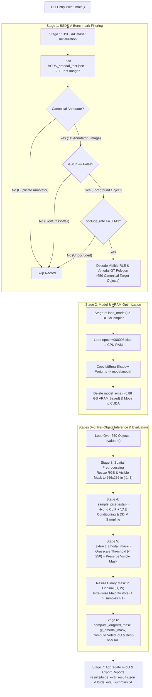
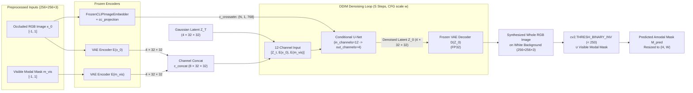

# `eval_bsds.py` — Architecture & Workflow Documentation

This document explains the end-to-end workflow of [`eval_bsds.py`](file:///home/thanhduy/Projects/pix2gestalt/eval_bsds.py) for evaluating **pix2gestalt** on the **BSDS-A (Amodal Berkeley Segmentation Dataset)** benchmark, structured into:

1. [**1. Configuration (`Confile` & CLI Parameters)**](#1-configuration-confile--cli-parameters)
2. [**2. Step-by-Step Execution Workflow (`Flow`)**](#2-step-by-step-execution-workflow-flow)
3. [**3. Architecture & Pipeline Diagrams (`Diagram`)**](#3-architecture--pipeline-diagrams-diagram)
4. [**4. Reflection of the Original Paper & Official Code (`Paper Mapping`)**](#4-reflection-of-the-original-paper--official-code-paper-mapping)

---

## 1. Configuration (`Confile` & CLI Parameters)

The evaluation pipeline is governed by two configuration layers:

1. **Model YAML Configuration** ([`sd-finetune-pix2gestalt-c_concat-256.yaml`](file:///home/thanhduy/Projects/pix2gestalt/pix2gestalt/configs/sd-finetune-pix2gestalt-c_concat-256.yaml)) — defines the Latent Diffusion architecture, conditioning encoders, and latent space dimensions.
2. **Runtime CLI Configuration** ([`main()`](file:///home/thanhduy/Projects/pix2gestalt/eval_bsds.py#L1404-L1631)) — controls dataset filtering, DDIM sampling hyperparameters, mask extraction, and hardware precision.

### 1.1 Model YAML Config (`sd-finetune-pix2gestalt-c_concat-256.yaml`)

| Config Section           | Key Parameters                                                                           | Role in `eval_bsds.py`                                                                                                                                                                                                                              |
| :----------------------- | :--------------------------------------------------------------------------------------- | :-------------------------------------------------------------------------------------------------------------------------------------------------------------------------------------------------------------------------------------------------- |
| **`model.params`**       | `conditioning_key: hybrid` `image_size: 32`, `channels: 4` `scale_factor: 0.18215` | Configures a hybrid-conditioned Latent Diffusion Model operating on $32 \times 32 \times 4$ latent tensors (downsampled $8\times$ from $256 \times 256$ RGB).                                                                                       |
| **`unet_config`**        | `in_channels: 12` `out_channels: 4` `context_dim: 768`                             | Denoising U-Net taking 12 latent channels concatenated along channel dim: $Z_t$ (4ch noisy latent) + $\mathcal{E}(x_0)$ (4ch input RGB latent) + $\mathcal{E}(m_{\text{vis}})$ (4ch visible mask latent), cross-attending to 768-d CLIP embeddings. |
| **`first_stage_config`** | `target: AutoencoderKL` `resolution: 256`, `z_channels: 4` `ch_mult: [1, 2, 4, 4]` | Frozen KL-regularized Variational Autoencoder (VAE) that encodes $256 \times 256 \times 3$ images/masks into $32 \times 32 \times 4$ latents and decodes denoised latents back to RGB.                                                              |
| **`cond_stage_config`**  | `target: FrozenCLIPImageEmbedder`                                                        | Frozen CLIP ViT image encoder extracting high-level semantic tokens from the occluded input image, projected via `cc_projection` for U-Net cross-attention.                                                                                         |

### 1.2 Runtime CLI Arguments (`eval_bsds.py`)

| Category                 | CLI Flag             |                     Default                     | Paper / Reproduction Setting | Description                                                                                                                      |
| :----------------------- | :------------------- | :---------------------------------------------: | :--------------------------: | :------------------------------------------------------------------------------------------------------------------------------- |
| **Model & Paths**        | `--config`           | `.../sd-finetune-pix2gestalt-c_concat-256.yaml` |             Same             | Model architecture config file.                                                                                                  |
|                          | `--ckpt`             |      `pix2gestalt/ckpt/epoch=000005.ckpt`       |             Same             | Official 15.4 GB fine-tuned checkpoint (5 epochs).                                                                               |
|                          | `--dataset_dir`      |                   `data/bsds`                   |         `data/bsds`          | Root folder containing `images/` and `annotations/BSDS_amodal_test.json`.                                                        |
| **Dataset Filtering**    | `--benchmark_650`    |                     `True`                      |            `True`            | Enforces 1 canonical annotator per image and `occlude_rate >= 0.141` to isolate the exact 650 benchmark objects.                 |
|                          | `--no_benchmark_650` |                     `False`                     |           `False`            | Evaluates all 963 occluded objects (`occlude_rate > 0`) for the first annotator.                                                 |
|                          | `--include_stuff`    |          `False` (`ignore_stuff=True`)          |           `False`            | Excludes background "stuff" regions (`isStuff == True`, e.g., sky, grass, road).                                                 |
| **Diffusion Sampling**   | `--resolution`       |                      `256`                      |            `256`             | Native spatial size ($256 \times 256$) for VAE & CLIP conditioning.                                                              |
|                          | `--ddim_steps`       |                  `200` (paper)                  |        `200` (paper)         | Number of DDIM denoising steps $S$ (pass `--ddim_steps 50` for fast evaluation).                                                 |
|                          | `--n_samples`        |                   `3` (paper)                   |         `3` (paper)          | Number of stochastic samples generated per object (used for Majority Vote and Best-of-3).                                        |
|                          | `--guidance_scale`   |                      `2.0`                      |            `2.0`             | Classifier-Free Guidance (CFG) scale $w$.                                                                                        |
| **Pre/Post-Processing**  | `--crop_bbox`        |                     `False`                     |           `False`            | `False` uses whole-frame resizing (official `app.py`); `True` crops a square context window with `--margin_ratio 1.1`.           |
|                          | `--threshold`        |                      `250`                      |            `250`             | Grayscale intensity threshold (`cv2.THRESH_BINARY_INV` at 250) separating synthesized object from pure white background (`255`). |
| **Hardware & Precision** | `--precision`        |                   `autocast`                    |     `autocast` / `fp32`      | Uses FP16 autocast for U-Net/CLIP while keeping VAE decoding in FP32 to prevent overflow.                                        |
|                          | `--half` / `--fp16`  |                     `False`                     |           Optional           | Casts U-Net and conditioning weights to FP16 on GPUs with $<12\text{ GB}$ VRAM.                                                  |

---

## 2. Step-by-Step Execution Workflow (`Flow`)

The execution in [`eval_bsds.py`](file:///home/thanhduy/Projects/pix2gestalt/eval_bsds.py) proceeds through **7 core stages**:

### Stage 0: Environment & Legacy Checkpoint Compatibility ([Lines 35–110](file:///home/thanhduy/Projects/pix2gestalt/eval_bsds.py#L35-L110))

1. **`pkg_resources` Shim:** Modern `setuptools >= 82.0.0` removed `pkg_resources`, which crashes legacy `pytorch_lightning==1.4.2` and `torchmetrics==0.6.0` imports. [`eval_bsds.py`](file:///home/thanhduy/Projects/pix2gestalt/eval_bsds.py#L37-L58) dynamically injects an `importlib.metadata`-backed `pkg_resources` module into `sys.modules`.
2. **PyTorch 2.6+ Safe Unpickling:** Monkey-patches `torch.load` ([Lines 70–87](file:///home/thanhduy/Projects/pix2gestalt/eval_bsds.py#L70-L87)) to default `weights_only=False` so legacy PyTorch Lightning checkpoints containing `ModelCheckpoint` callbacks load cleanly on PyTorch 2.x.

### Stage 1: Dataset Loading & Canonical Filtering ([`BSDSADataset`, Lines 703–1180](file:///home/thanhduy/Projects/pix2gestalt/eval_bsds.py#L703-L1180))

1. **Source Resolution:** [`BSDSADataset.__init__`](file:///home/thanhduy/Projects/pix2gestalt/eval_bsds.py#L719-L798) resolves data from one of four modes:
   - Pre-extracted mask directories (`visible_masks/` and `amodal_masks/`).
   - Official COCOA/BSDS-A annotation file (`BSDS_amodal_test.json`) via [`_load_from_cocoa_json`](file:///home/thanhduy/Projects/pix2gestalt/eval_bsds.py#L950-L1085).
   - Automatic synthetic benchmark annotations on the 200 real BSDS500 test images (`--auto_synth_ann`, [`_generate_synthetic_bsds_annotations`](file:///home/thanhduy/Projects/pix2gestalt/eval_bsds.py#L799-L904)).
   - Quick 2-sample smoke test (`--dummy_test`, [`_init_dummy_samples`](file:///home/thanhduy/Projects/pix2gestalt/eval_bsds.py#L906-L949)).
2. **Benchmark Filtering Rules ([Lines 980–1065](file:///home/thanhduy/Projects/pix2gestalt/eval_bsds.py#L980-L1065)):**
   - **Rule 1 (Single Canonical Annotator):** BSDS500 contains 5–7 human annotators per image. Filtering to the first canonical annotator per `image_id` prevents multi-annotator duplication.
   - **Rule 2 (Ignore "Stuff"):** Regions marked `isStuff == True` (background regions like sky, road, grass, walls) are skipped.
   - **Rule 3 (Occluded Objects Only):** Unoccluded objects (`occlude_rate <= 0`) are excluded. When `benchmark_650=True`, `min_occlude_rate = 0.141` isolates the exact **650 occluded target objects** across the 200 test images reported in the paper.
3. **Mask Decoding:** Decodes RLE (`pycocotools.mask`) or polygon segmentation coordinates into binary NumPy arrays (`visible_mask_np` and `amodal_gt_mask_np`).

### Stage 2: Model Instantiation & EMA VRAM Optimization ([`load_model`, Lines 135–276](file:///home/thanhduy/Projects/pix2gestalt/eval_bsds.py#L135-L276))

1. **Integrity Check:** Verifies that `epoch=000005.ckpt` exists and is complete ($\ge 14\text{ GB}$, expected $\sim 15.4\text{ GB}$).
2. **CPU-First Loading:** Loads the state dict into system RAM (`map_location="cpu"`) and instantiates `LatentDiffusion` via `instantiate_from_config(config.model)`.
3. **EMA Shadow Buffer Optimization ([Lines 249–256](file:///home/thanhduy/Projects/pix2gestalt/eval_bsds.py#L249-L256)):**
   - Standard `LitEma` stores a duplicate shadow copy of all U-Net parameters ($\sim 3.44\text{ GB}$) and clones the U-Net again on GPU upon entering `model.ema_scope()` ($\sim 3.44\text{ GB}$).
   - `load_model` permanently copies the trained EMA weights into `model.model` on CPU (`model.model_ema.copy_to(model.model)`) and deletes `model.model_ema`, **saving $\sim 6.88\text{ GB}$ of GPU VRAM** without altering inference outputs.

### Stage 3: Spatial Preprocessing ([`predict_amodal_mask`, Lines 509–680](file:///home/thanhduy/Projects/pix2gestalt/eval_bsds.py#L509-L680))

For each object instance $(I_{\text{RGB}}, M_{\text{vis}})$ of original size $(H, W)$:

- **Default Whole-Frame Mode (`crop_bbox=False`, [Lines 634–640](file:///home/thanhduy/Projects/pix2gestalt/eval_bsds.py#L634-L640)):**
  - Resizes the full image $I_{\text{RGB}}$ to $(256, 256)$ using `cv2.INTER_AREA` and normalizes pixel values to $[-1, 1]$ via [`process_input_tensor`](file:///home/thanhduy/Projects/pix2gestalt/eval_bsds.py#L413-L427).
  - Resizes the binary visible mask $M_{\text{vis}}$ to $(256, 256)$ using `cv2.INTER_NEAREST`, replicates it across 3 channels (`[0, 255]`), and normalizes to $[-1, 1]$.
- **Optional Object-Centric Crop Mode (`crop_bbox=True`, [Lines 570–594](file:///home/thanhduy/Projects/pix2gestalt/eval_bsds.py#L570-L594)):**
  - Computes the visible bounding box via [`get_bbox_from_mask`](file:///home/thanhduy/Projects/pix2gestalt/eval_bsds.py#L282-L293) and expands a square context patch of side $S = \max(h_{\text{obj}}, w_{\text{obj}}) \times \text{margin\_ratio}$ centered on the object via [`compute_square_crop_coords`](file:///home/thanhduy/Projects/pix2gestalt/eval_bsds.py#L296-L335) before resizing to $(256, 256)$.

### Stage 4: Hybrid Conditioning & DDIM Sampling ([`sample_pix2gestalt`, Lines 431–506](file:///home/thanhduy/Projects/pix2gestalt/eval_bsds.py#L431-L506))

Inside `@torch.no_grad()` and `precision_scope`:

1. **Cross-Attention Conditioning (`c_crossattn`):**
   - Encodes the input image tensor through Frozen CLIP (`model.get_learned_conditioning`), tiles across `n_samples`, and projects via `model.cc_projection` ([Lines 460–462](file:///home/thanhduy/Projects/pix2gestalt/eval_bsds.py#L460-L462)).
2. **Spatial Concatenation Conditioning (`c_concat`):**
   - Encodes both the input RGB tensor and 3-channel visible mask tensor through the frozen VAE encoder (`model.encode_first_stage(...).mode()`) to produce two $4 \times 32 \times 32$ latent maps.
   - Concatenates them along the channel dimension into an $8 \times 32 \times 32$ conditioning tensor ([Lines 465–468](file:///home/thanhduy/Projects/pix2gestalt/eval_bsds.py#L465-L468)).
3. **Classifier-Free Guidance (CFG):**
   - When `guidance_scale != 1.0`, constructs an all-zero unconditional conditioning dict `uc` matching both `c_crossattn` and `c_concat` shapes ([Lines 470–474](file:///home/thanhduy/Projects/pix2gestalt/eval_bsds.py#L470-L474)).
4. **DDIM Reverse Process & VAE Decoding:**
   - Runs `sampler.sample(S=ddim_steps, shape=[4, 32, 32], ...)` to synthesize the completed whole object on a white background in latent space.
   - Casts latents to `float32` and decodes via `model.decode_first_stage` into $N$ RGB images of shape $(256, 256, 3)$ in $[0, 255]$ ([Lines 492–499](file:///home/thanhduy/Projects/pix2gestalt/eval_bsds.py#L492-L499)).

### Stage 5: Amodal Mask Extraction & Modal Preservation ([`extract_amodal_mask`, Lines 353–407](file:///home/thanhduy/Projects/pix2gestalt/eval_bsds.py#L353-L407))

For each synthesized $256 \times 256$ RGB completion:

1. **Background Thresholding:** Converts the synthesized RGB image to grayscale and applies inverse binary thresholding at `threshold = 250` (`cv2.threshold(gray, 250, 255, cv2.THRESH_BINARY_INV)`), extracting all non-white pixels as the predicted amodal object mask. (Alternatively supports Euclidean RGB distance from `[255, 255, 255]` if `--distance_threshold` is set).
2. **Visible Mask Guarantee:** Enforces $M_{\text{amodal}} \supseteq M_{\text{vis}}$ via `np.maximum(mask, vis_bin)` ([Lines 403–405](file:///home/thanhduy/Projects/pix2gestalt/eval_bsds.py#L403-L405)) so bright highlights on the visible portion of the object are never thresholded away as white background.
3. **Uncropping / Resizing to Original Canvas:** Resizes the binary mask back to $(H, W)$ using `cv2.INTER_NEAREST` (or uncrops from the square patch if `crop_bbox=True`) and re-applies `np.maximum` with the full-resolution `vis_mask_2d` ([Lines 667–669](file:///home/thanhduy/Projects/pix2gestalt/eval_bsds.py#L667-L669)).

### Stage 6: Multi-Sample Aggregation & Metric Evaluation ([`evaluate`, Lines 1185–1399](file:///home/thanhduy/Projects/pix2gestalt/eval_bsds.py#L1185-L1399))

1. **Majority Voting (`n_samples > 1`):** Averages the $N$ predicted binary masks pixel-wise and thresholds at $\ge 0.5$ (`np.mean(np.stack(all_sample_masks, axis=0), axis=0) >= 0.5`, [Line 673](file:///home/thanhduy/Projects/pix2gestalt/eval_bsds.py#L673)).
2. **IoU Calculation ([`compute_iou`, Lines 685–697](file:///home/thanhduy/Projects/pix2gestalt/eval_bsds.py#L685-L697)):**
   $$\text{IoU}(M_{\text{pred}}, M_{\text{gt}}) = \frac{|M_{\text{pred}} \cap M_{\text{gt}}|}{|M_{\text{pred}} \cup M_{\text{gt}}|}$$
   Computes both the **Standard/Voted mIoU** and, when `n_samples > 1`, the **Best-of-$N$ mIoU** ($\max_{k \in \{1..N\}} \text{IoU}(M_{\text{pred}}^{(k)}, M_{\text{gt}})$).
3. **Artifacts Output:** Saves per-instance and summary metrics to `results/bsds_eval_results.json`, `results/bsds_eval_summary.txt`, and optional 5-panel visualization strips to `results/vis/`.

---

## 3. Architecture & Pipeline Diagrams (`Diagram`)

### 3.1 End-to-End Evaluation Workflow Diagram

### 3.2 Hybrid Conditioning & Latent Diffusion Architecture (`sample_pix2gestalt`)

---

## 4. Reflection of the Original Paper & Official Code (`Paper Mapping`)

The implementation in [`eval_bsds.py`](file:///home/thanhduy/Projects/pix2gestalt/eval_bsds.py) directly reflects the methodology, equations, and evaluation protocol from the CVPR 2024 paper (**"pix2gestalt: Amodal Segmentation by Synthesizing Wholes"**, Ozguroglu et al., [arXiv:2401.14398](https://arxiv.org/pdf/2401.14398.pdf)), the BSDS-A dataset paper (Zhu et al., CVPR 2017), and the authors' official codebase ([`pix2gestalt/app.py`](file:///home/thanhduy/Projects/pix2gestalt/pix2gestalt/app.py) and [`pix2gestalt/inference.py`](file:///home/thanhduy/Projects/pix2gestalt/pix2gestalt/inference.py)).

### 4.1 Mapping Table: Paper Sections & Pages $\leftrightarrow$ `eval_bsds.py`

| Paper Reference (Ozguroglu et al., CVPR 2024)                                                   | Paper Concept / Protocol                                                                                                                                                                                                                                                                                                                                                                                   | Implementation in `eval_bsds.py` & Official Repo                                                                                                                                                                                                                                                                                                                                                                                                                                                                                                                                                                                                                       |
| :---------------------------------------------------------------------------------------------- | :--------------------------------------------------------------------------------------------------------------------------------------------------------------------------------------------------------------------------------------------------------------------------------------------------------------------------------------------------------------------------------------------------------- | :--------------------------------------------------------------------------------------------------------------------------------------------------------------------------------------------------------------------------------------------------------------------------------------------------------------------------------------------------------------------------------------------------------------------------------------------------------------------------------------------------------------------------------------------------------------------------------------------------------------------------------------------------------------------- |
| **Section 3.2, Page 4 (Eq. 1–2 & Fig. 3)** _Conditional Latent Diffusion Architecture_       | Formulates amodal completion as learning $p(x \mid x_0, m_{\text{vis}})$. Uses a dual-stream conditioning mechanism: 1. **Semantic stream:** CLIP image embedding of input image $x_0$ via cross-attention. 2. **Spatial stream:** Channel concatenation of VAE-encoded input image $\mathcal{E}(x_0)$ and visible mask $\mathcal{E}(m_{\text{vis}})$ with noisy latent $z_t$ ($4+4+4=12$ channels). | - [`sample_pix2gestalt()`](file:///home/thanhduy/Projects/pix2gestalt/eval_bsds.py#L458-L489) - Matches [`pix2gestalt/inference.py` (Lines 65–81)](file:///home/thanhduy/Projects/pix2gestalt/pix2gestalt/inference.py#L65-L81) - Config [`unet_config.params.in_channels: 12`](file:///home/thanhduy/Projects/pix2gestalt/pix2gestalt/configs/sd-finetune-pix2gestalt-c_concat-256.yaml#L32)                                                                                                                                                                                                                                                                    |
| **Section 3.2, Page 4** _Classifier-Free Guidance (CFG)_                                     | During training, conditioning is randomly dropped out so the model can be sampled with Classifier-Free Guidance by zeroing out both `c_crossattn` and `c_concat`.                                                                                                                                                                                                                                          | - [`sample_pix2gestalt()` (Lines 470–474)](file:///home/thanhduy/Projects/pix2gestalt/eval_bsds.py#L470-L474): constructs zero tensors for `uc["c_crossattn"]` and `uc["c_concat"]`. - Matches [`pix2gestalt/inference.py` (Lines 82–87)](file:///home/thanhduy/Projects/pix2gestalt/pix2gestalt/inference.py#L82-L87).                                                                                                                                                                                                                                                                                                                                             |
| **Section 3.3, Page 5** _Amodal Segmentation from Synthesized Wholes_                        | Because the model synthesizes the completed whole object over a pure white background, converting amodal completion to an amodal segmentation mask requires only simple thresholding on the generated RGB image.                                                                                                                                                                                           | - [`extract_amodal_mask()` (Lines 389–395)](file:///home/thanhduy/Projects/pix2gestalt/eval_bsds.py#L389-L395): `gray = cv2.cvtColor(sample_img, cv2.COLOR_RGB2GRAY)` `_, pred_thresh = cv2.threshold(gray, 250, 255, cv2.THRESH_BINARY_INV)` - Mirrors [`pix2gestalt/app.py` (`get_mask_from_pred`, Lines 140–155)](file:///home/thanhduy/Projects/pix2gestalt/pix2gestalt/app.py#L140-L155), where the authors explicitly state: _"For evaluation, we use direct thresholding [at 250]."_                                                                                                                                                                   |
| **Section 3.3 & Section 4.1, Pages 5–6** _Probabilistic Sampling: Majority Vote & Best-of-3_ | Occlusion completion is inherently ill-posed/multimodal. To evaluate deterministic vs. multi-hypothesis accuracy, the authors sample 3 completions per object and report: 1. **Pixel-wise Majority Vote** across the 3 masks. 2. **Best-of-3** (oracle selection of highest IoU among the 3 samples).                                                                                                | - **Majority Vote:** [`predict_amodal_mask()` (Line 673)](file:///home/thanhduy/Projects/pix2gestalt/eval_bsds.py#L673): `pred_mask_orig = (np.mean(np.stack(all_sample_masks, axis=0), axis=0) >= 0.5)` - **Best-of-$N$:** [`evaluate()` (Lines 1279–1282)](file:///home/thanhduy/Projects/pix2gestalt/eval_bsds.py#L1279-L1282): `sample_ious = [compute_iou(m, gt_amodal_mask) for m in sample_masks]` `best_iou = max(sample_ious)`                                                                                                                                                                                                                    |
| **Section 4.1, Page 5–6 & Table 1 (Page 6)** _BSDS-A Benchmark Dataset & Metric (mIoU)_      | Evaluates zero-shot amodal segmentation on **BSDS-A** (Amodal Berkeley Segmentation Dataset, derived from BSDS500 test set by Zhu et al., CVPR 2017). - Metric: **Mean Intersection-over-Union (mIoU)** of the amodal mask. - Paper Table 1 targets on BSDS-A:  • **pix2gestalt (Majority Vote):** ~**80.76%** mIoU  • **pix2gestalt (Best-of-3):** ~**85.68%** mIoU                           | - [`BSDSADataset._load_from_cocoa_json()` (Lines 950–1085)](file:///home/thanhduy/Projects/pix2gestalt/eval_bsds.py#L950-L1085) filters out `isStuff == True`, duplicate annotators, and unoccluded regions (`occlude_rate >= 0.141`), isolating the **650 canonical occluded objects** across the 200 BSDS test images. - [`compute_iou()` (Lines 685–697)](file:///home/thanhduy/Projects/pix2gestalt/eval_bsds.py#L685-L697) computes exact binary mask IoU, and [`evaluate()` (Lines 1334–1340)](file:///home/thanhduy/Projects/pix2gestalt/eval_bsds.py#L1334-L1340) logs both Voted mIoU and Best-of-$N$ mIoU alongside the paper's Table 1 reference values. |

### 4.2 Engineering Refinements in `eval_bsds.py` Over Raw `app.py`

While preserving 100% fidelity to the paper's model and evaluation protocol, [`eval_bsds.py`](file:///home/thanhduy/Projects/pix2gestalt/eval_bsds.py) introduces three key engineering improvements over the interactive Gradio script ([`pix2gestalt/app.py`](file:///home/thanhduy/Projects/pix2gestalt/pix2gestalt/app.py)):

1. **Thresholding Before Upsampling (Avoiding Lanczos Ringing):**
   - In [`app.py` (Lines 177–181)](file:///home/thanhduy/Projects/pix2gestalt/pix2gestalt/app.py#L177-L181), `cv2.resize(..., cv2.INTER_LANCZOS4)` is applied to the RGB image _before_ thresholding at 250, which can introduce ringing artifacts near boundaries against the `255` white background.
   - In [`eval_bsds.py` (Lines 658–669)](file:///home/thanhduy/Projects/pix2gestalt/eval_bsds.py#L658-L669), `extract_amodal_mask` thresholds the native $256 \times 256$ diffusion output first and resizes the clean binary mask to $(H, W)$ via `cv2.INTER_NEAREST`.
2. **Strict Modal Mask Preservation ($M_{\text{amodal}} \supseteq M_{\text{vis}}$):**
   - By definition of amodal perception, the whole object mask must include its visible modal mask. If a visible object contains specular highlights or white texture ($\ge 250$), simple grayscale thresholding would create false holes inside the visible region. [`extract_amodal_mask` (Lines 403–405)](file:///home/thanhduy/Projects/pix2gestalt/eval_bsds.py#L403-L405) takes the union `np.maximum(mask, vis_bin)` to guarantee zero loss of visible foreground pixels.
3. **VRAM Reduction (~22–28 GB $\rightarrow$ <10 GB):**
   - The original [`README.md` (Line 53)](file:///home/thanhduy/Projects/pix2gestalt/README.md#L53) notes that `app.py` requires 22–28 GB VRAM (due to SAM-ViT-H + CarveKit + duplicate `LitEma` shadow buffers). By folding `model_ema` weights in-place on CPU ([Lines 249–256](file:///home/thanhduy/Projects/pix2gestalt/eval_bsds.py#L249-L256)) and running ground-truth modal conditioning under FP16 `autocast`, [`eval_bsds.py`](file:///home/thanhduy/Projects/pix2gestalt/eval_bsds.py) runs comfortably on standard 8–12 GB GPUs.
